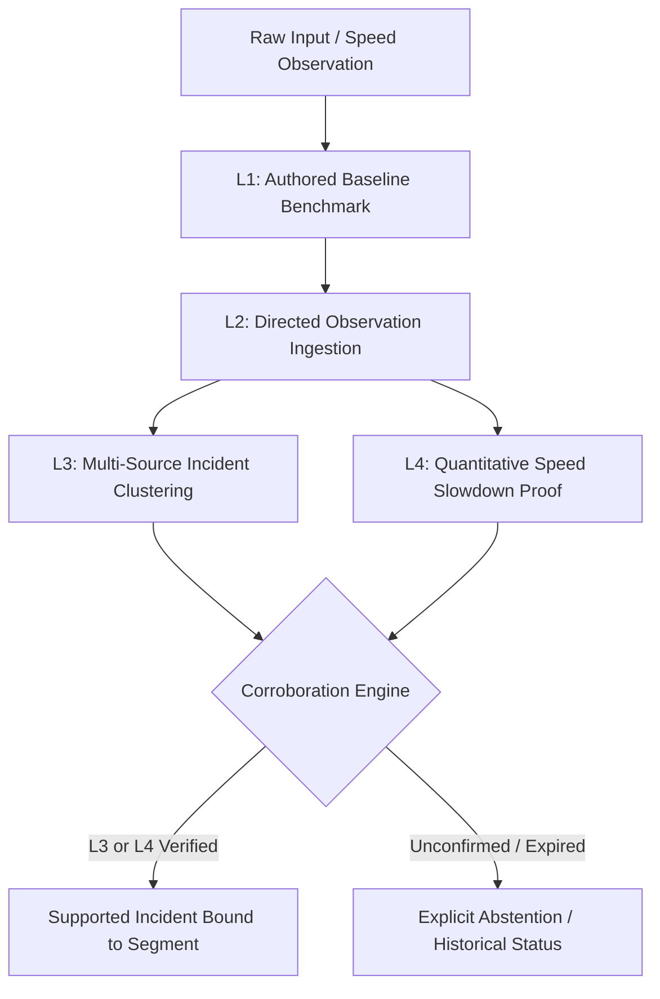
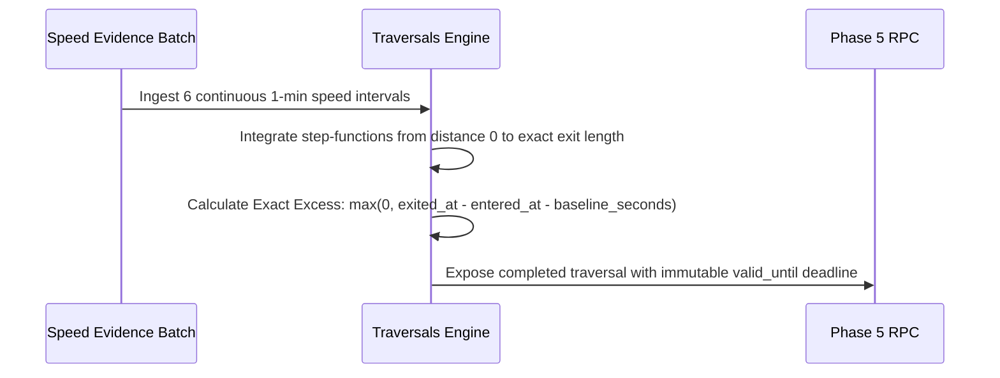
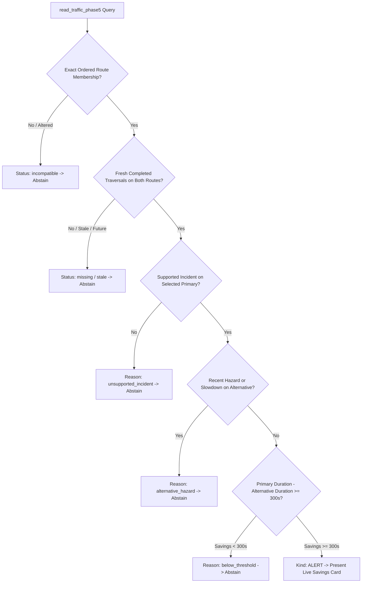
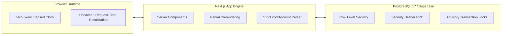

# TrafficSense: Decentralized Civic Traffic Intelligence & Corroborated Mobility Platform

> **A Comprehensive Architectural Whitepaper, System Specification, and Research Reference**  
> **Core Framework**: `REPORT → VERIFY → ALERT → ANALYSE`  
> **Deployment Context**: Mangaluru Smart Mobility Corridor (Tier-2 Arterial Demonstration)  
> **Engine**: Next.js 16 (App Router + Turbopack) · PostgreSQL 17 / Supabase · Row-Level Security · MapLibre GL  Dockerized 

---

## Table of Contents
1. [The Big Idea: Philosophy & Vision](#1-the-big-idea-philosophy--vision)
2. [The Problem Landscape: Why Conventional Traffic Systems Fail](#2-the-problem-landscape-why-conventional-traffic-systems-fail)
3. [The Core Solution: Deterministic Evidence-Based Corroboration](#3-the-core-solution-deterministic-evidence-based-corroboration)
4. [End-to-End System Architecture & Data Workflows](#4-end-to-end-system-architecture--data-workflows)
   - [Workflow A: Citizen Reporting & Episode Clustering](#workflow-a-citizen-reporting--episode-clustering)
   - [Workflow B: Multi-Tier Corroboration Engine (L1–L4)](#workflow-b-multi-tier-corroboration-engine-l1l4)
   - [Workflow C: Piecewise Traversal Integration & Delay Proof](#workflow-c-piecewise-traversal-integration--delay-proof)
   - [Workflow D: Fixed-Route Comparison & Alert Abstention Engine](#workflow-d-fixed-route-comparison--alert-abstention-engine)
   - [Workflow E: Consent-Guaranteed Commuter-Employer Sharing](#workflow-e-consent-guaranteed-commuter-employer-sharing)
   - [Workflow F: Civic Hotspot Prioritization & Analytics](#workflow-f-civic-hotspot-prioritization--analytics)
5. [User Interfaces & Responsive Experience Design](#5-user-interfaces--responsive-experience-design)
6. [Algorithmic Efficiency & Engineering Guarantees](#6-algorithmic-efficiency--engineering-guarantees)
7. [Module-by-Module Feature Breakdown](#7-module-by-module-feature-breakdown)
8. [Comparative Evaluation: TrafficSense vs Traditional Platforms](#8-comparative-evaluation-trafficsense-vs-traditional-platforms)
9. [Local Execution, Docker Setup & Verification Suite](#9-local-execution-docker-setup--verification-suite)
10. [Native Mobile Application Architecture & Plan](#10-native-mobile-application-architecture--plan)

---

## 1. The Big Idea: Philosophy & Vision

Modern urban transit is plagued by two extremes: **unverified citizen noise** on one end (social media rumors, spam reports, unconfirmed crowd alerts) and **invasive proprietary tracking** on the other (commercial navigation apps harvesting continuous 24/7 background GPS coordinates).

**TrafficSense** is a civic traffic intelligence engine built on a four-stage verified lifecycle:
```
┌──────────────┐     ┌──────────────┐     ┌──────────────┐     ┌──────────────┐
│  1. REPORT   │ ──> │  2. VERIFY   │ ──> │   3. ALERT   │ ──> │  4. ANALYSE  │
│ Citizen/Auth │     │ Multi-source │     │ Sub-second   │     │ Actionable   │
│ Crowd Inputs │     │  L1–L4 Proof │     │ Savings Only │     │ Hotspot Data │
└──────────────┘     └──────────────┘     └──────────────┘     └──────────────┘
```

### The Foundational Tenets
1. **Explainable Truth Over Blind Prediction**: Never publish an unverified traffic spike or phantom hazard without transparent, inspectable evidence indicators.
2. **Zero-Tracking Privacy by Design**: Commuters should never surrender continuous geolocation tracking to obtain traffic delay verification or share commute disruption notices with employers.
3. **Conservative Decision Discipline (Abstention)**: If evidence is stale, conflicting, below threshold, or if an alternative path is blocked by hazards, the system explicitly **abstains** rather than providing misleading advice.
4. **Separation of Delay and Blame**: Traffic delay calculations measure verified excess physical traversal time across arterial segments; they do not adjudicate personal tardiness or employee intent.

### 1.1 System Provenance: What Is Real, Estimated, and Simulated

Per our strict honesty rules, every number and status in TrafficSense carries an explicit provenance indicator:

| Subsystem | Operational Status | Provenance Label in UI |
|---|---|---|
| **Map, roads & places** | Real (OpenStreetMap via hosted vector tiles & OpenFreeMap) | OSM attribution on every map |
| **Routes & alternatives** | Real routing across Mangaluru road network (OSRM), **free-flow estimate** | `ESTIMATED · Free-flow only` |
| **Incident reporting** | Real rows from real users at real GPS coordinates | Verification level shown (L1–L3) |
| **Verification engine** | Real rules run and enforced by the PostgreSQL server (PostGIS) | Level + reason shown |
| **Journey excess time** | Real trip time minus free-flow estimate computed by server | `Time over free-flow estimate` |
| **Live speed for every road** | **Not available** (requires millions of users or proprietary feeds) | Never claimed |
| **Corridor multi-month history** | Real rows from live database + optional synthetic history | Labelled `LIVE DATA` or `SIMULATED` |
| **Authority confirmation** | Role-checked database function with immutable audit logging | `L6 · Officially Confirmed` |

---

## 2. The Problem Landscape: Why Conventional Traffic Systems Fail

| Challenge | Existing Navigation Apps (e.g. Google Maps, Waze) | Real-World Impact | TrafficSense Architectural Remedy |
|---|---|---|---|
| **Crowdsourced Noise & Spoofing** | Anyone can report a closed road or hazard with zero corroboration. Bots and malicious drivers easily spoof reports. | Ghost traffic jams, unnecessary diversions, emergency panic. | **L1–L3 Corroboration**: Reports must be clustered into immutable episodes; requires $\ge 3$ distinct sources within 15 mins for L3 elevation. |
| **Pervasive Surveillance** | Constant background location tracking, device fingerprinting, journey logging. | Massive privacy violations; user location sold or leaked. | **No continuous tracking**: Commuters generate synthetic journey IDs; reports bind to segment IDs without persistent location footprints. |
| **Employer Tardiness Disputes** | Employees arrive late due to gridlock; employers demand proof; employees must take photos or screenshots. | Friction, lack of institutional trust, fake excuse notes. | **Consent-Based Employer Portal**: Commuters share an allowlisted summary (Delay, Corridor, Evidence Level). Zero GPS or coordinates disclosed. |
| **Deceptive "Shortcuts"** | Algorithms re-route thousands of cars down narrow residential alleys for a 30-second hypothetical gain. | Neighborhood gridlock, damaged local infrastructure, safety hazards. | **Fixed Arterial Routes & Strict 5-Min Threshold**: Only alerts if verified traversal savings on arterial routes equal or exceed **exactly 300 seconds (5 min)**. |
| **Municipal Blind Spots** | Municipalities lack actionable aggregate data; incident duration is confused with total commuter delay. | Traffic lights aren't retimed; high-frequency accident zones go unaddressed. | **Civic Analytics Engine**: Reconciles monthly delay-hours, recurrence indexes, and peak windows across junctions for infrastructure planning. |

---

## 3. The Core Solution: Deterministic Evidence-Based Corroboration

TrafficSense replaces heuristics and probabilistic guessing with **four deterministic tiers of corroborated evidence**:



### The Corroboration Hierarchy
* **L1 (Authored Baseline)**: Defined by physical corridor geometry ($1500\,\text{m}$, $180\,\text{s}$ baseline speed $= 30\,\text{km/h}$). Represents free-flow transit conditions.
* **L2 (Raw Single-Source Observation)**: Fresh, single synthetic source speed observation within an active 20-minute window. Marked as *unconfirmed*.
* **L3 (Multi-Source Cluster)**: Requires $\ge 3$ eligible, distinct, non-expired reports bound to the same directed corridor segment within 15 minutes. Protects against single-device spam or malicious fabrication.
* **L4 (Quantitative Continuous Slowdown)**: Requires contiguous speed observations spanning **six exact one-minute intervals (5 complete minutes)** where all bound sources register speeds $\le 40\%$ of the segment's authored baseline.

---

## 4. End-to-End System Architecture & Data Workflows

```
┌────────────────────────────────────────────────────────────────────────────────────────┐
│                                   CLIENT LAYER                                         │
│  Public Demo (/demo) │ Traffic Explorer (/traffic) │ Workspace (/workspace)            │
│  Report Desk (/reports/new) │ Employer Portal (/employer/[id]) │ Authority (/authority)│
└────────────────────────────────────────────────────────────────────────────────────────┘
                                           │ HTTP/JSON
                                           ▼
┌────────────────────────────────────────────────────────────────────────────────────────┐
│                           APPLICATION LAYER (Next.js 16)                               │
│  - App Router with Partial Prerendering (PPR)                                          │
│  - Turbopack Compilation Engine                                                        │
│  - Strict Server-Side Allowlist Parsers (apps/web/src/lib/route-alerts/snapshot.ts)   │
│  - Pure Domain Presentation Engines (Asia/Kolkata Formatting, Zero-Skew Timer Clocks)  │
└────────────────────────────────────────────────────────────────────────────────────────┘
                                           │ SQL / RPC
                                           ▼
┌────────────────────────────────────────────────────────────────────────────────────────┐
│                        DATA & SECURITY LAYER (PostgreSQL 17)                           │
│  - Row-Level Security (RLS) on all public tables                                       │
│  - Non-Login Security Definer Reader Roles (phase5_snapshot_reader)                    │
│  - Rejection of Caller-Supplied Clocks (All windows anchored to statement_timestamp()) │
│  - Piecewise Forward Integration Engine (exact microsecond traversal exits)            │
└────────────────────────────────────────────────────────────────────────────────────────┘
```

---

### Workflow A: Citizen Reporting & Episode Clustering
1. **Submission**: A commuter or guest visits `/reports/new` and selects a segment, direction, and structured category (`accident`, `road_repair`, `heavy_volume`, `flood`, `unknown`).
2. **Server-Issued Identity**: The server stamps the report with a cryptographic UUID and assigns a private source hash. Guest reports receive a transient server cookie; authenticated users bind to their user UUID.
3. **Episode Linkage**: The database groups contemporaneous reports within 15 minutes on the same segment into an `incident_episode`. If reports cease for 15 minutes, the episode automatically closes.

---

### Workflow B: Multi-Tier Corroboration Engine (L1–L4)
1. **Speed Evidence Ingestion**: Batch speed evidence runs (`speed_evidence_batches`) ingest sensor observations every 60 seconds.
2. **Cadence Verification**: The database validates that exactly six contiguous samples exist across a 5-minute interval.
3. **Lifecycle State Transition**:
   - $\text{speed} \le 0.4 \times \text{baseline}$ for 5 minutes $\rightarrow$ **`supported`** incident created.
   - $\text{speed} > 0.4 \times \text{baseline}$ continuously for 5 minutes $\rightarrow$ **`cleared`** with recovery proof.
   - Observation window exceeds 20 minutes without new evidence $\rightarrow$ **`stale`** / **`withdrawn`**.

---

### Workflow C: Piecewise Traversal Integration & Delay Proof
Traditional systems calculate delay by dividing segment length by the latest instantaneous speed. **TrafficSense forbids this**, because an instantaneous speed change misrepresents vehicle motion.

Instead, the database executes **Piecewise Forward Integration**:
$$\text{Distance}(t) = \int_{t_{\text{entry}}}^{t_{\text{exit}}} v(t)\, dt = \sum_{k} v_k \cdot \Delta t_k = \text{Segment Length}$$



* **Delay Arithmetic**: $\text{Excess Microseconds} = \max(0, t_{\text{exit}} - t_{\text{entry}} - \text{baseline\_seconds} \times 10^6)$.
* A 675-second traversal against a 180-second baseline yields **exactly 495 seconds** of verified delay.
* Faster-than-baseline travel yields 0 excess seconds; it never subtracts or masks delay on downstream segments.

---

### Workflow D: Fixed-Route Comparison & Alert Abstention Engine
The system monitors two fixed arterial corridors in Mangaluru:
* **Primary Route (Outbound)**: `primary-west` ($1500\,\text{m}$, $180\,\text{s}$) $\rightarrow$ `primary-east` ($1000\,\text{m}$, $120\,\text{s}$). Baseline $= 300\,\text{s}$.
* **Alternative Route (Outbound)**: `alternative-west` ($2200\,\text{m}$, $240\,\text{s}$) $\rightarrow$ `alternative-east` ($1200\,\text{m}$, $180\,\text{s}$). Baseline $= 420\,\text{s}$.



#### Strict Mathematical Abstention Rules
| Trigger Condition | Route Comparison Status | UI Presentation Behavior |
|---|---|---|
| Route segment deleted, swapped, or reordered | `incompatible` | "No route alert · Route inputs have incompatible direction or baseline" |
| Completed traversals older than 20 minutes | `stale` | "No route alert · Completed route traversals are stale; refresh needed" |
| Alternative route has recent unconfirmed hazard | `available` (reason: `alternative_hazard`) | "No route alert · The alternative has a recent reported, unconfirmed hazard" |
| Alternative route has active slowdown incident | `available` (reason: `alternative_slowdown`) | "No route alert · The alternative has a current supported simulated slowdown" |
| Traversal difference is 299.999999s ($< 300\,\text{s}$) | `available` (reason: `below_threshold`) | "No route alert · Simulated estimated time difference is below five minutes" |
| **Traversal difference is $\ge 300.000000\,\text{s}$ AND Primary has supported incident** | **`available` (kind: `alert`)** | **"Simulated estimated time difference · X seconds less on the fixed alternative"** |

---

### Workflow E: Consent-Guaranteed Commuter-Employer Sharing

```
COMMUTER DEVICE                                                   EMPLOYER DESK
(Role: commuter)                                                (Role: employer)
       │                                                               │
       │ 1. Start Journey (/workspace)                                 │
       │    [Status: Active, Private to Commuter]                      │
       │                                                               │
       │ 2. Select Employer & Grant Consent                            │
       │    [Share Created: journey_employer_shares]                   │
       │                                                               │
       │                               3. Employer Opens /employer/[id]│
       │                                  Calls read_employer_shared...│
       │                                                               │
       │                               4. Return Allowlisted Fields:   │
       │                                  - Journey Ref UUID           │
       │                                  - Corridor Name              │
       │                                  - Status: ACTIVE             │
       │                                  - Delay: ~8 min (480s)       │
       │                                  - Evidence: L3 Corroborated  │
       │                                  - Shared Timestamp           │
       │                                  [ZERO GPS / ZERO COORDINATES]│
       │                                                               │
       │ 5. Commuter Clicks "Stop Sharing" OR "End Journey"            │
       │    [Share Status -> STOPPED / Journey -> ENDED]               │
       │                                                               │
       │                               6. Employer Refreshes Page      │
       │                                  [Entry IMMEDIATELY VANISHES] │
```

---

### Workflow F: Civic Hotspot Prioritization & Analytics
Civic engineers and municipal authorities access `/authority` to analyze longitudinal historical traffic trends:
1. **Deterministic Dataset**: Synthesizes multi-month traffic disruption history for Mangaluru's key traffic nodes:
   - *Hampankatta Junction* (Central Commercial Zone)
   - *KSRTC / Bejai Circle* (Interstate Bus Terminal Corridor)
   - *Ambedkar (Jyothi) Circle* (Educational & Hospital Arterial)
   - *Ladyhill Junction* (Northern Coastal Arterial)
   - *Pumpwell Circle* (Southern Highway Confluence)
2. **Metrics Derivation**:
   - $\text{Total Delay-Hours} = \sum \text{Commuter Delay Minutes} / 60$.
   - Hotspot rankings sorted descending by aggregated commuter delay burden.
   - Categorical cause mix (Collisions, Road Maintenance, Heavy Volume, Monsoon Waterlogging, Unverified).
   - Peak window distribution (Morning Peak: `08:00–10:00`, Evening Peak: `17:00–19:00`, Off-Peak).
3. **One-Click CSV Export**: Direct client-side generation and download of structured investigation logs for urban planning teams.

---

## 5. User Interfaces & Responsive Experience Design

The TrafficSense design system is built to provide maximum clarity during high-stress traffic situations, adapting seamlessly across desktop, tablet, and mobile screens.

```
+---------------------------------------------------------------------------------------+
|  TRAFFICSENSE MANGALURU                              [Demo Pill] [Workspace] [Sign In]|
+---------------------------------------------------------------------------------------+
|  +-------------------------------------------+  +-----------------------------------+ |
|  |           MAP EXPLORER (MapLibre GL)      |  |          CORRIDOR SEGMENTS        | |
|  |                                           |  |                                   | |
|  |   [Primary-West] ======== [Primary-East]  |  |  [!] Primary-West (Active Slowdown| |
|  |        \\                       //        |  |      Delay: +495s · L4 Verified   | |
|  |         [Alt-West] ===== [Alt-East]       |  |                                   | |
|  |                                           |  |  [*] Alternative Route            | |
|  |   [Direction: OUTBOUND v]                 |  |      Baseline: 420s · Clear       | |
|  +-------------------------------------------+  +-----------------------------------+ |
|  +----------------------------------------------------------------------------------+ |
|  |  FIXED ALTERNATIVE COMPARISON (Phase 5 Alert Card)                               | |
|  |  [ALERT] 320 seconds less on the fixed alternative route                         | |
|  |  Bound to Incident #6c491f94 · Valid for next 14m 22s                            | |
|  +----------------------------------------------------------------------------------+ |
+---------------------------------------------------------------------------------------+
```

### Core Design Principles
* **Direction First**: Direction (`outbound` vs `inbound`) is a first-class filter. Selecting a segment updates the map camera, the detail inspector, and the route comparison in strict synchronization.
* **Live Assessment Clocks**: Evidence deadlines count down live in the browser using millisecond deltas against the server read timestamp, neutralizing client device clock skew.
* **Responsive Breakpoints**:
  - **Desktop ($1440\,\text{px}$)**: Side-by-side split screen (MapLibre viewport on the left, segment inspection list and comparison cards on the right).
  - **Mobile ($390\,\text{px}$)**: Stacked single-column hierarchy; map collapses to a touch-optimized pan/zoom container above segment cards.
  - **Narrow Mobile ($320\,\text{px}$)**: Full horizontal safety margins; text wraps cleanly without overflowing container boundaries.

---

## 6. Algorithmic Efficiency & Engineering Guarantees



### 1. Clock Tampering & Skew Immunity
* **Database Rejection of Client Clocks**: All RPCs (`read_traffic_phase5`, `project_completed_traversal`, `evaluate_incident_lifecycle`) derive validity strictly from `statement_timestamp()`. Caller-provided timestamps are rejected with SQL error code `42501` or ignored.
* **Browser Timer Resilience**: If a commuter's mobile device sleeps, suspends tabs, or changes system time, the presentation layer measures real elapsed time using `performance.now()` deltas against the immutable server read instant, instantly expiring stale alerts.

### 2. Microsecond Numerical Integrity
* Microsecond precision is preserved throughout calculations (`timestamptz` differences in microseconds).
* Exact threshold equality tests prove that **$299.999999\,\text{s}$ abstains**, while **$300.000000\,\text{s}$ alerts**.

### 3. Least-Privilege Role Isolation
* Public queries run through restricted non-login SQL roles (`phase5_snapshot_reader`).
* The application code possesses **no service_role master key** in browser contexts.
* Direct access to raw observer tables (`speed_evidence_observations`, `traffic_reports_private`) is revoked from all authenticated and anonymous clients.

---

## 7. Module-by-Module Feature Breakdown

| Module | Feature Code | Primary URL | Core Functional Capabilities |
|---|---|---|---|
| **Module 1** | Auth & Profiles | `/login`, `/register`, `/workspace` | Role assignment (`commuter`, `employer`, `authority`, `admin`), guest sessions, secure session cookies, profile isolation. |
| **Module 2** | Traffic Corridor Map | `/traffic`, `/demo` | MapLibre GL corridor visualization, directional filters, segment geometry overlays, real-time segment selection. |
| **Module 3** | Incident Reporting | `/reports/new` | Citizen incident submission, category allowlist, server-side anti-abuse throttling, public/private data separation. |
| **Module 4** | Evidence & Traversals | `/traffic` (inspect) | Immutable speed evidence batches, L1–L4 corroboration badges, piecewise completed traversals, recovery proofs. |
| **Module 5** | Alternative-Route Alerts | `/traffic` (alerts) | Dual-route traversal subtraction, 5-minute threshold trigger, conservative hazard/slowdown abstention. |
| **Module 6** | Journeys & Employer Sharing | `/workspace`, `/employer/[id]` | Commuter journey tracker, recipient-bound sharing consent, allowlisted employer summary, instantaneous access revocation. |
| **Module 7** | Hotspots & Civic Analytics | `/authority` | Multi-month junction incident aggregations, hotspot delay rankings, cause mix percentages, CSV export. |
| **Extension** | Protected Delay Receipts | `/workspace` (planned) | Ed25519 cryptographic receipts binding verified traversal delay to an intended employer without location tracking. |

---

## 8. Comparative Evaluation: TrafficSense vs Traditional Platforms

| Dimension | Commercial Turn-by-Turn GPS (e.g. Google Maps, Waze) | Municipal Smart City Portals | **TrafficSense Platform** |
|---|---|---|---|
| **Location Tracking** | Continuous, background tracking of latitude/longitude coordinates. | Static roadside cameras or inductive loop sensors. | **Zero continuous tracking.** Segment-level aggregation only. |
| **Verification Basis** | Proprietary black-box machine learning algorithms. | Manual operator confirmation (slow, high overhead). | **Transparent L1–L4 Corroboration Engine** with inspectable proofs. |
| **Re-routing Philosophy** | Reroutes traffic for fractional (e.g. 30s) theoretical savings. | No real-time routing provided. | **Conservative Arterial Comparison**; requires $\ge 5$ min verified savings. |
| **Employer Tardiness Verification** | None; employees take screenshots or photos of traffic. | Inaccessible to private sector employers. | **Allowlisted Delay Summary**: verifiable, consented, zero GPS disclosure. |
| **Civic Data Usability** | Proprietary data locked behind expensive commercial APIs. | Infrequent, delayed municipal PDF reports. | **Interactive Authority Dashboard** with hotspot rankings from real report counts & CSV export. |

---

## 9. Local Execution, Docker Setup & Verification Suite

The entire application runs inside reproducible Docker containers. No host package dependencies or global databases are required.

### 1. Quick Start with `just` (Recommended)

If you have `just` installed, manage the entire lifecycle with single commands:

```bash
# Start local Supabase, seed synthetic accounts, and launch dev app on :3000
just up

# Inspect container health and port bindings
just status

# Run the 194 unit tests inside Docker
just test

# Run ESLint inside Docker
just lint

# Run full checks suite (tests, linter, typecheck, Next.js production build)
just check

# Stop dev & prod containers (preserving database and volume caches)
just down

# Stop all containers including local Supabase backend
just stop-all

# Start free Cloudflare Tunnel for public internet / mobile access
just tunnel
```

Run `just` or `just --list` to view all available commands. Complete installation and Cloudflare tunnel setup instructions are documented in [docs/setup.md](docs/setup.md).

### 2. Manual Docker Compose Execution

```bash
# 1. Start local Supabase PostgreSQL database
bash scripts/local-supabase.sh start

# 2. Seed synthetic demonstration accounts
bash scripts/local-supabase.sh seed

# 3. Launch the development server (port 3000)
docker compose up --build -d app

# 4. (Optional) Launch the production preview container (port 3001)
docker compose --profile production up --build -d production
```

### 3. Verification Suite Execution

```bash
# Run the complete automated test suite (194 unit tests, ESLint, TypeScript, Production Build)
docker compose run --build --rm checks

# Run the database-level integration & boundary rollback suite
bash scripts/local-supabase.sh test-route-alerts
```

---

## 10. Native Mobile Application Architecture & Plan

For high-performance mobile execution (iOS & Android) with hardware GNSS precision, 120 FPS native vector rendering, offline SQLite persistence, and driver safety ergonomics, a comprehensive multi-file mobile engineering specification is available in [`docs/mobile/`](docs/mobile/):

- 📖 **[Master Vision & Technology Stack](docs/mobile/README.md):** Technology evaluation (React Native + Expo), non-negotiable principles, monorepo code sharing.
- 🏗️ **[System Architecture & Data Pipelines](docs/mobile/architecture.md):** Layer diagram, WatermelonDB SQLite schema, hardware GNSS policy, session security.
- 🎨 **[UI/UX Design System & Tokens](docs/mobile/ui-design-system.md):** Daylight driving contrast tokens, typography, bottom sheets, 1-tap category grid, haptics.
- 📱 **[Core Feature Specifications](docs/mobile/feature-specs.md):** 1-tap reporting flow, dynamic OSRM routing & detours, delay receipts & employer QR pass, authority mode.
- 🚀 **[Native Optimizations: Better & Best](docs/mobile/native-optimizations.md):** Native MapLibre vs webview, zero-drain battery protocol, 120 FPS Reanimated 3, cold start <800ms.
- 🗺️ **[5-Phase Implementation Roadmap](docs/mobile/roadmap.md):** Detailed timeline, exit acceptance criteria, Jest & Maestro testing strategy, EAS CI/CD.

---

## Conclusion
TrafficSense proves that modern urban mobility applications do not need to sacrifice commuter privacy to provide institutional-grade traffic intelligence. By pairing **mathematically verified traversal delays** with **consent-based sharing** and **civic analytics**, TrafficSense establishes a reproducible standard for ethical smart city infrastructure.
