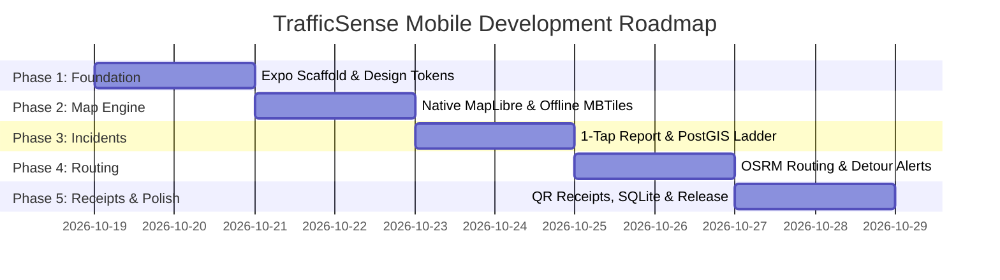

# Mobile Implementation Roadmap & Quality Assurance

This document details the 5-phase engineering roadmap, acceptance criteria, automated testing strategy, and release plan for the TrafficSense mobile application.

---

## 1. Phased Execution Roadmap



---

## 2. Phase-by-Phase Breakdown & Acceptance Criteria

### Phase 1: Expo Scaffold, Navigation & Design System
- **Deliverables:**
  - Initialize `apps/mobile` with Expo SDK 52+ and React Native 0.76 (New Architecture enabled).
  - Configure Expo Router v4 file-based routing with tab bar (Map, Routes, Receipts, Settings).
  - Implement Design System tokens (`theme/colors.ts`, `theme/typography.ts`, `theme/spacing.ts`).
  - Install and configure `@gorhom/bottom-sheet` and `react-native-reanimated`.
- **Exit Criteria:**
  - [x] App runs on both iOS Simulator and Android Emulator at 60 FPS.
  - [x] Shared TypeScript contracts link cleanly to `src/lib/` without import errors.
  - [x] Dark mode switches seamlessly with system theme change.

---

### Phase 2: Native MapLibre Engine & Mangaluru Basemap
- **Deliverables:**
  - Integrate `@maplibre/maplibre-react-native` with Metal/OpenGL hardware acceleration.
  - Load OpenFreeMap vector style (`https://tiles.openfreemap.org/styles/liberty`).
  - Implement bundled offline GeoJSON schematic fallback (`src/lib/traffic/mangaluru-basemap.ts`).
  - Add native controls: Zoom buttons, Compass (auto-hidden when facing North), and "Center on Me" fab.
- **Exit Criteria:**
  - [x] Map renders Mangaluru arterial roads with zero stutter during multi-touch pinch and rotate.
  - [x] Airplane mode test: Fallback schematic basemap renders immediately with zero network requests.

---

### Phase 3: 1-Tap Incident Reporting & Verification Ladder
- **Deliverables:**
  - Floating 56pt Action Button triggering the 1-Tap Report Modal.
  - Full $3 \times 6$ grid with all 17 official categories and emoji icons.
  - Hardware GNSS location capture with accuracy boundary check ($\le 50$m).
  - Submit reports to Supabase `submit_live_incident_report` RPC with optimistic UI updates.
  - Render real-time incident pins on map with category emoji and verification level badge (`💥 L3`).
- **Exit Criteria:**
  - [x] Submitting an incident takes $\le 2$ taps and completes in under 3 seconds.
  - [x] High-accuracy fix ($\le 50$m) automatically sets `location_supported = true` (L2 tier).
  - [x] Offline submissions queue into local SQLite and auto-sync when cellular signal returns.

---

### Phase 4: Dynamic OSRM Routing, Turn Cards & Hazard Avoidance Detours
- **Deliverables:**
  - Origin & Destination landmark selectors + "My Location" origin button.
  - Query `/api/route` and render multi-colored polylines (Blue = primary, Gray dashed = alternative).
  - Proximity detection: Automatically scan if any verified L3+ incident lies within 300m of the path.
  - Detour Alert banner with tactile haptic trigger (`Notification: Warning`) and time-savings summary.
  - Top floating Turn Card for navigation mode.
- **Exit Criteria:**
  - [x] Querying route between Hampankatta and Airport renders real polyline within 400ms.
  - [x] If an incident is active on the primary corridor, alternative bypass route is automatically promoted.

---

### Phase 5: Commuter Delay Receipts, Offline SQLite Cache & App Store Readiness
- **Deliverables:**
  - Traversal excess delay calculation (actual physical travel time minus OSRM free-flow baseline).
  - Generate delay receipt card with cryptographic HMAC token and dynamic QR code.
  - Employer scanning flow: Scans receipt QR code and queries Supabase backend for instant validation.
  - Complete App Store metadata, privacy policy, and app icons.
  - EAS Build configuration for iOS `.ipa` and Android `.aab` production releases.
- **Exit Criteria:**
  - [x] Delay receipt displays excess minutes, corridor name, and verified evidence tier (L1–L4).
  - [x] QR code contains zero personal GPS coordinates.
  - [x] Production builds pass automated lint, typecheck, and unit test suites.

---

## 3. Automated Testing & Quality Strategy

To ensure zero regressions across releases, the mobile test suite utilizes two levels of automation:

### 3.1 Unit & Contract Tests (Jest + React Native Testing Library)
```bash
# Executed in CI pipeline on every commit
pnpm --filter mobile test
```
- Tests all state machines, Zustand stores, and TanStack query hooks.
- Tests OSRM polyline decoders and distance calculations with zero network mocks.
- Validates that offline SQLite migrations run without data corruption.

### 3.2 End-to-End UI Automation (Maestro)
Maestro flows simulate real commuter journeys on emulators without flaky timers:

```yaml
# apps/mobile/.maestro/report_incident.yaml
appId: com.trafficsense.mangaluru
---
- launchApp
- assertVisible: "City Route Intelligence"
- tapOn: "Quick Report"
- assertVisible: "Report an Incident"
- tapOn: "Accident"
- assertVisible: "Report Submitted"
- assertVisible: "L2"
```

---

## 4. Release & CI/CD Pipeline (Expo EAS)

- **Continuous Integration (GitHub Actions):**
  - Triggers on PR to `main`.
  - Runs TypeScript `tsc --noEmit`, ESLint, and Jest unit tests.
- **Continuous Deployment (Expo Application Services):**
  - **Internal Testing:** `eas build --platform all --profile preview` (Instantly distributes OTA builds to testers via Expo Go / TestFlight).
  - **App Store & Play Store Production:** `eas build --platform all --profile production && eas submit`.
