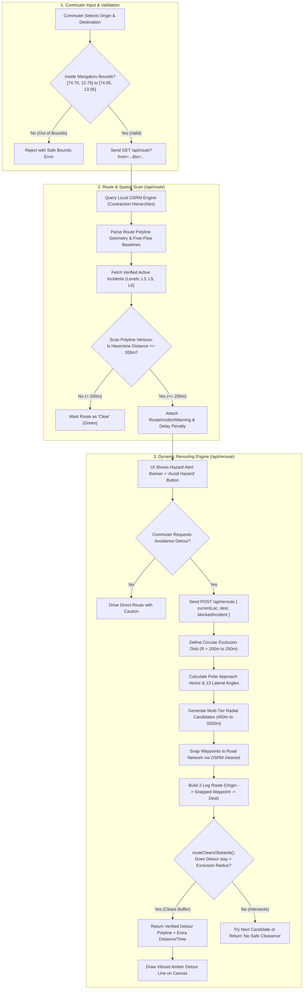
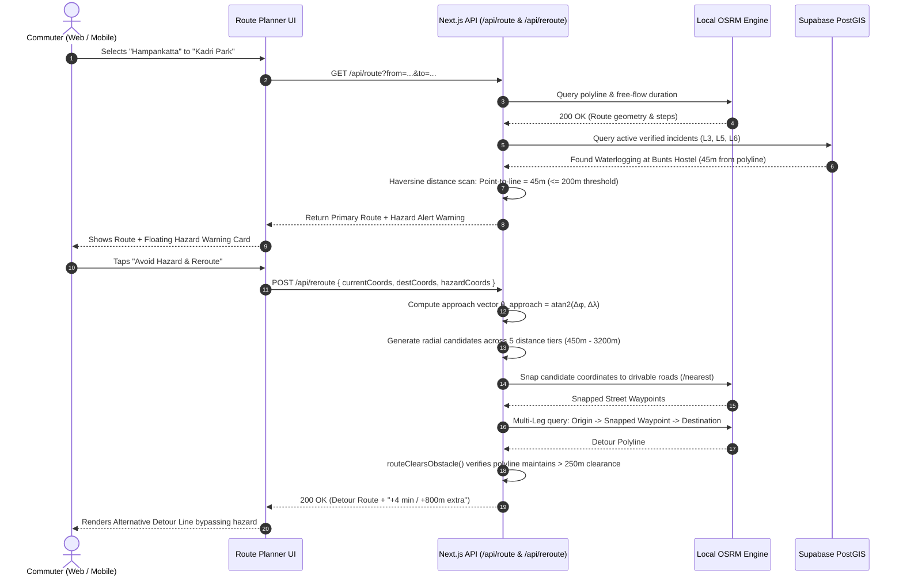

# TrafficSense — Route Planning & Dynamic Rerouting Engine Architecture

> **Technical Architecture, Mathematical Models & Algorithmic Flow Specification**  
> Comprehensive guide covering coordinate-accurate navigation, OSRM pathfinding, Haversine spatial buffers, polar vector detour generation, and departure clearance math.

---

## 1. Executive 5W1H Matrix (Who, What, Why, Where, How)

| Dimension | Specification | Implementation Detail |
|---|---|---|
| **WHO triggers it?** | • Commuters on Web & Mobile<br>• Moving drivers approaching road hazards<br>• Traffic Authorities evaluating corridor spread | Triggered by origin/destination change in `RoutePlanner`, or clicking **"Avoid Hazard & Detour"** |
| **WHAT happens?** | • Generates multi-criteria route options (Primary, Avoid, Balanced)<br>• Scans polylines for verified `L3+` incidents within 200m<br>• Calculates radial bypass waypoints around obstacles | Next.js API endpoints `/api/route` & `/api/reroute` interacting with local OpenStreetMap/OSRM engine |
| **WHY is it built?** | • Prevents drivers from entering active hazards & floods<br>• Eliminates blind black-box ETAs with legal free-flow baselines<br>• Prevents false "No Alternative" locks via safe departure clearance | Haversine proximity buffer + vector departure math (`routeClearsObstacle`) |
| **WHERE does it run?** | • **Client**: React / MapLibre (Web) & Expo / Leaflet (Mobile)<br>• **Backend**: Next.js Serverless Route Handlers<br>• **Engine**: OSRM Routing Engine (Dockerized) over OpenStreetMap Mangaluru | End-to-end local Docker stack (`compose.yaml`) with zero external API fees |
| **WHEN does it trigger?** | 1. User picks/swaps Origin & Destination<br>2. Active hazard spotted along current polyline<br>3. Commuter clicks "Avoid Hazard & Detour"<br>4. Authority runs Pumpwell corridor spread check | Synchronous client HTTP calls with 5-minute memory caching |
| **HOW does it work?** | 1. Bounding check $\rightarrow$ 2. OSRM polyline fetch $\rightarrow$ 3. Spatial buffer scan $\rightarrow$ 4. Radial waypoint detour $\rightarrow$ 5. Clearance check | Multi-step geometric pipeline diagrammed below |

---

## 2. End-to-End Decision Flowchart



---

## 3. Sequence Lifecycle Diagram



---

## 4. Mathematical Formulations & Core Algorithms

### 4.1. Haversine Great-Circle Geodesic Distance Formula
Used across all spatial calculations (`engine.ts`, `reroute.ts`, `spread.ts`) to compute true spherical surface distances between two coordinates $P_1(\lambda_1, \phi_1)$ and $P_2(\lambda_2, \phi_2)$ on Earth (where $\lambda = \text{longitude}$, $\phi = \text{latitude}$):

$$\phi_1 = \text{lat}_1 \cdot \frac{\pi}{180}, \quad \phi_2 = \text{lat}_2 \cdot \frac{\pi}{180}$$

$$\Delta\phi = (\text{lat}_2 - \text{lat}_1) \cdot \frac{\pi}{180}, \quad \Delta\lambda = (\text{lon}_2 - \text{lon}_1) \cdot \frac{\pi}{180}$$

The square of half the chord length between the points:
$$a = \sin^2\left(\frac{\Delta\phi}{2}\right) + \cos(\phi_1) \cdot \cos(\phi_2) \cdot \sin^2\left(\frac{\Delta\lambda}{2}\right)$$

The angular distance in radians:
$$c = 2 \cdot \text{atan2}\left(\sqrt{a}, \sqrt{1 - a}\right)$$

Resulting geodesic surface distance in meters (using mean Earth radius $R = 6,371,000\text{ m}$):
$$d = R \cdot c$$

*Numerical Benefit*: Using $\text{atan2}$ rather than $\arccos$ prevents floating-point rounding errors at very small distances ($< 10\text{m}$).

---

### 4.2. Point-to-Polyline Minimum Distance Algorithm
`minDistanceToRoute(point, routeCoords)` scans the route polyline $\mathcal{P} = [V_0, V_1, \dots, V_n]$ to determine the closest approach distance to an incident $H$:

$$d_{\min}(H, \mathcal{P}) = \min_{0 \le i \le n} \left( \text{Haversine}(H, V_i) \right)$$

- **Spatial Buffer Rule**:
  $$\text{Incident Detected On Route} \iff d_{\min}(H, \mathcal{P}) \le 200\text{ meters}$$
- **Anti-Panic Rule**:
  Only incidents with verification level $\in \{\text{L3}, \text{L5}, \text{L6}\}$ trigger route alerts. Unconfirmed single-user $\text{L1}$ reports are excluded from navigation interruption.

---

### 4.3. Polar Vector Approach & Radial Waypoint Generation
`generateCandidateWaypoints(currentLocation, incidentPoint, radii)` computes prospective detour coordinates dynamically bypassing the obstruction.

#### Step A: Approach Vector & Bearing
Computes the vector from the commuter $C(\lambda_c, \phi_c)$ to the incident $I(\lambda_i, \phi_i)$:
$$\Delta\lambda = \lambda_i - \lambda_c, \quad \Delta\phi = \phi_i - \phi_c$$
$$\theta_{\text{approach}} = \text{atan2}(\Delta\phi, \Delta\lambda)$$

#### Step B: Lateral Angular Spectrum
Generates 13 directional diversion angles relative to the approach line:
$$\Delta\theta \in \{+90^\circ, -90^\circ, +60^\circ, -60^\circ, +120^\circ, -120^\circ, +45^\circ, -45^\circ, +135^\circ, -135^\circ, +150^\circ, -150^\circ, 180^\circ\}$$

#### Step C: Multi-Tiered Radial Distances
Expands across 5 concentric radius tiers around the hazard epicenter:
$$r \in \{450\text{m}, 750\text{m}, 1200\text{m}, 2000\text{m}, 3200\text{m}\}$$

#### Step D: Metric-to-Coordinate Geodesic Projection
Transforms polar coordinates $(r, \theta)$ into WGS84 geographic coordinates:
$$\theta = \theta_{\text{approach}} + \Delta\theta$$
$$\text{latMPerDeg} = 111,000\text{ m/deg}$$
$$\text{lngMPerDeg} = 111,000 \cdot \cos\left(\phi_i \cdot \frac{\pi}{180}\right)\text{ m/deg}$$

$$\Delta\phi_{\text{offset}} = \frac{r \cdot \sin(\theta)}{\text{latMPerDeg}}, \quad \Delta\lambda_{\text{offset}} = \frac{r \cdot \cos(\theta)}{\text{lngMPerDeg}}$$

$$\text{Candidate Coordinate} = \left(\lambda_i + \Delta\lambda_{\text{offset}}, \; \phi_i + \Delta\phi_{\text{offset}}\right)$$

---

### 4.4. Road Network Snapping (Hidden Markov Model / KD-Tree Nearest Neighbor)
Raw radial coordinates could land on water (Arabian Sea, Netravati River), buildings, or steep cliffs.
The engine invokes OSRM `/nearest`:
$$\text{SnappedNode} = \text{OSRM\_Nearest}(\text{CandidateCoord})$$
- Evaluates closest drivable road segment edge in the OpenStreetMap road graph.
- Discards candidates with snapping distance $> 350\text{m}$ (off-road or inaccessible).

---

### 4.5. Trajectory Departure Clearance Algorithm (`routeClearsObstacle`)
Solves the **Departing Driver Problem**: if a driver starts parked 120m from a roadblock, a naive $250\text{m}$ exclusion filter would reject *all* possible routes with a false *"No Alternative Route"* error.

```
                  Obstacle (Epicenter)
                          [ X ]
                            ^
                            | (Danger: < 40m forbidden)
                     d_start = 120m
                            |
   Commuter [Start] --------+--------> Moving Away (Approved!)
                            |
              min_distance >= d_start - 60m
```

#### The Three Mathematical Conditions:
1. **Epicenter Hard Exclusion**:
   The route must NEVER penetrate the inner accident/obstruction core:
   $$\min_{V \in \text{Route}} d(V, H) \ge 40\text{ meters}$$

2. **Monotonic Departure Clearance**:
   If the starting position is within the exclusion zone ($d_{\text{start}} \le R_{\text{exclusion}} + 25\text{m}$):
   $$\min_{V \in \text{Route}} d(V, H) \ge \max\left(40\text{m}, \; d_{\text{start}} - 60\text{m}\right)$$
   *(The driver is legally moving away from the hazard, not driving closer into it).*

3. **Cumulative Perimeter Clearance**:
   For all vertices along the path after the driver has driven past the immediate departure zone ($\sum \Delta s > 250\text{m}$):
   $$d(V_i, H) \ge R_{\text{exclusion}} \quad (\forall i \text{ where cumulative distance} > 250\text{m})$$
   *(Prevents the route from looping back through the roadblock later in the journey).*

---

### 4.6. Graph Pathfinding: Contraction Hierarchies & MLD
The underlying routing solver inside the OSRM Docker container executes **Contraction Hierarchies (CH)** on the Mangaluru OSM street network:
- **Preprocessing**: Hierarchy of shortcut edges added to the directed graph $\mathcal{G} = (\mathcal{V}, \mathcal{E})$.
- **Query Phase**: Bidirectional Dijkstra search executing on upward shortcut graphs:
  $$\text{Query Time Complexity: } \mathcal{O}(|\mathcal{E}'| + |\mathcal{V}'| \log |\mathcal{V}'|) \approx 2\text{ms to } 5\text{ms}$$
  *(Enables instant sub-10ms response times without external API latency).*

---

### 4.7. Multi-Objective Detour Scoring & Ranking Function
When multiple road detours safely clear the incident exclusion zone, the engine must select the globally optimal alternative without routing the commuter into secondary traffic jams. The candidate ranking score is evaluated via an objective penalty function:

$$\mathcal{J}(R) = T_{\text{duration}}(R) + \omega_{\text{hazard}} \cdot N_{\text{secondary\_hazards}}(R)$$

Where:
- $T_{\text{duration}}(R)$ is the estimated travel time in seconds for detour route $R$.
- $N_{\text{secondary\_hazards}}(R)$ is the count of other verified active incidents (levels L3, L5, L6) within 200m of route $R$.
- $\omega_{\text{hazard}} = 600\text{ seconds}$ (a heavy 10-minute penalty per secondary hazard, strictly prioritizing hazard-free routes over minor travel time savings).
- **Optimal Detour Selection:**
  $$R^* = \arg\min_{R \in \mathcal{R}_{\text{valid}}} \mathcal{J}(R)$$

---

### 4.8. Commuter Delta Metrics & Transparency Formulations
To inform the commuter transparently of detour trade-offs (e.g. `"+4 min · +800m"`), the engine computes non-negative duration and distance deltas against the unobstructed direct baseline:

$$\Delta T = \max\left(0, \; T_{\text{detour}} - T_{\text{direct}}\right)$$

$$\Delta D = \max\left(0, \; D_{\text{detour}} - D_{\text{direct}}\right)$$

If the direct route baseline fails or is already completely blocked, $\Delta T = 0$ and $\Delta D = 0$ are gracefully reported without breaking UI state.

---

### 4.9. Arterial Parallel Corridor Expansion Algorithm
In cases where direct topological alternatives around an obstacle fail or OSRM returns only 1 route, the engine dynamically injects strategic Mangaluru arterial corridor waypoints (Kottara Chowki / NH66, Kuntikan / Derebail, Vamanjoor / Gurupura, Bikarnakatte):

1. **Distance Guard Filter**: Candidate corridor waypoint $C$ is rejected if too close to origin or destination:
   $$\text{Haversine}(\text{Start}, C) \ge 700\text{m} \quad \land \quad \text{Haversine}(\text{Dest}, C) \ge 700\text{m}$$
2. **Hazard Clearance Filter**:
   $$\text{Haversine}(C, \text{Obstacle}) \ge 2 \cdot R_{\text{exclusion}}$$
3. **Elongation Bound Heuristic**:
   $$T_{\text{alt}} \le 1.5 \cdot T_{\text{primary}} \quad \land \quad D_{\text{alt}} \le 1.5 \cdot D_{\text{primary}}$$
   *(Rejects absurd detours that would add over 50% extra distance or travel time).*

---

## 5. Algorithmic Complexity & Performance Table

| Phase | Algorithm / Math Model | Time Complexity | Space Complexity | Latency Budget |
|---|---|:---:|:---:|:---:|
| **Bounding Check** | 2D Axis-Aligned Bounding Box (AABB) | $\mathcal{O}(1)$ | $\mathcal{O}(1)$ | $< 0.05\text{ ms}$ |
| **Direct Pathfinding** | OSRM Contraction Hierarchies (CH) | $\mathcal{O}(\|\mathcal{E}\| + \|\mathcal{V}\| \log \|\mathcal{V}\|)$ | $\mathcal{O}(\|\mathcal{V}\|)$ | $2 - 6\text{ ms}$ |
| **Spatial Hazard Scan** | Discrete Vertex Haversine Scan | $\mathcal{O}(N_{\text{incidents}} \cdot N_{\text{vertices}})$ | $\mathcal{O}(1)$ | $< 0.8\text{ ms}$ |
| **Bypass Candidates** | Polar Vector Rotation & Projection | $\mathcal{O}(K_{\text{radii}} \cdot K_{\text{angles}})$ | $\mathcal{O}(K)$ | $< 0.2\text{ ms}$ |
| **Road Snapping** | OSRM R-Tree / KD-Tree Nearest Search | $\mathcal{O}(\log \|\mathcal{V}\|)$ | $\mathcal{O}(1)$ | $3 - 8\text{ ms}$ |
| **Detour Clearance** | `routeClearsObstacle` Trajectory Math | $\mathcal{O}(N_{\text{detour\_vertices}})$ | $\mathcal{O}(1)$ | $< 0.4\text{ ms}$ |
| **Detour Cost Scoring** | Multi-Objective Penalty Function $\mathcal{J}(R)$ | $\mathcal{O}(K_{\text{valid\_detours}})$ | $\mathcal{O}(1)$ | $< 0.05\text{ ms}$ |
| **Corridor Expansion** | Parallel NH66 / Arterial Corridor Fallback | $\mathcal{O}(M_{\text{corridors}} \cdot T_{\text{OSRM}})$ | $\mathcal{O}(M)$ | $4 - 10\text{ ms}$ |
| **Total Engine Budget** | End-to-End Dynamic Avoidance Pipeline | — | — | **$< 25\text{ ms}$** |

---

## 6. Summary Comparison: Primary vs. Avoidance Detour

| Dimension | Primary (Direct) Route | Dynamic Detour Route |
|---|---|---|
| **Route Line Styling** | Solid Primary Teal (`#0f766e`) | Solid High-Visibility Amber (`#d97706`) |
| **Hazard Proximity** | Crosses or passes $\le 200\text{m}$ of incident | Verified $> 250\text{m}$ clear of obstacle |
| **Waypoint Chain** | Origin $\rightarrow$ Destination | Origin $\rightarrow$ Snapped Bypass Node $\rightarrow$ Destination |
| **Commuter Feedback** | Shows distance, time & hazard warning badge | Shows extra distance, extra minutes & bypass street name |
| **Clearance Guarantee** | Standard free-flow path | Formally verified via `routeClearsObstacle` |
