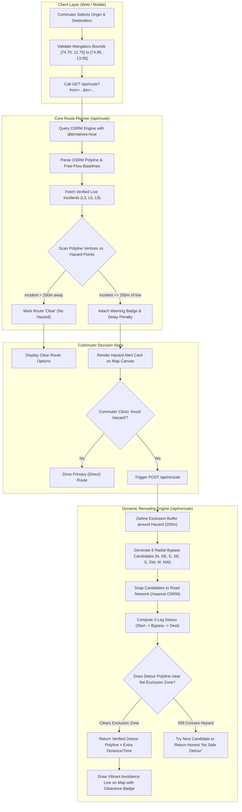
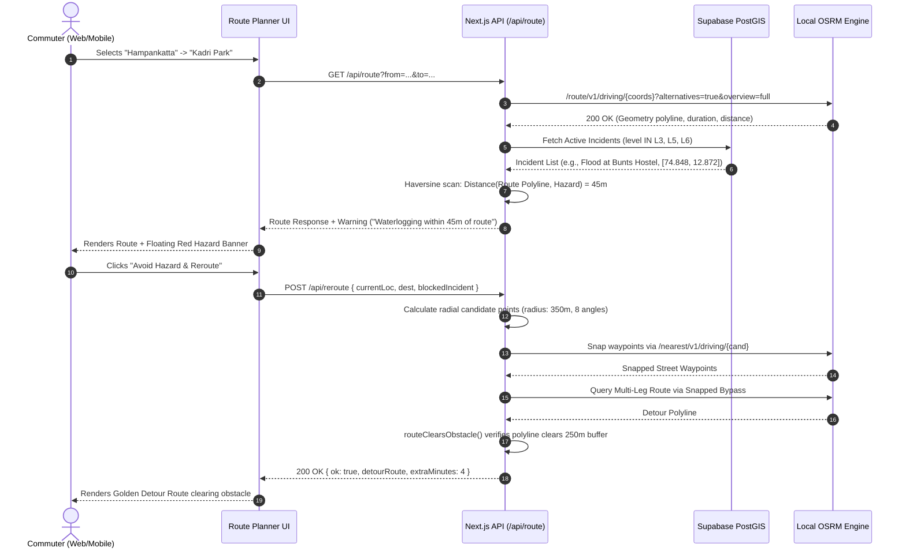

# TrafficSense — Route Planning & Dynamic Rerouting Engine Architecture

> **Technical Architecture & Flow Specification**  
> Covers coordinate-accurate navigation, OSRM integration, multi-tier hazard warnings, and radial detour recalculation.

---

## 1. Executive 5W1H Matrix (Who, What, Why, Where, How)

| Question | Answer | Technical Implementation |
|---|---|---|
| **WHO triggers it?** | • Commuters on Web & Mobile • Moving drivers near road hazards • Traffic Authorities evaluating corridor impact | User actions in `RoutePlanner` UI, background GPS track evaluation, or Authority spread checker |
| **WHAT happens?** | • Computes multi-criteria route options (Primary, Avoid, Balanced) • Scans polylines for verified L3+ incidents within 200m • Calculates radial bypass waypoints around obstacles | Next.js API endpoints `/api/route` & `/api/reroute` interacting with local OpenStreetMap/OSRM engine |
| **WHY is it built?** | • Prevents drivers from entering active hazards & congestion • Eliminates blind black-box ETAs with verifiable free-flow baselines • Prevents false "No Alternative" locks via safe departure clearance | Haversine proximity buffer + geometric clearance math (`routeClearsObstacle`) |
| **WHERE does it run?** | • **Client**: React / MapLibre (Web) & Expo / Leaflet (Mobile) • **Backend**: Next.js Serverless Route Handlers • **Engine**: OSRM Routing Engine (Dockerized) over OpenStreetMap Mangaluru | End-to-end local Docker stack (`compose.yaml`) with zero external API fees |
| **WHEN does it trigger?** | 1. User picks/swaps Origin & Destination 2. Active hazard spotted along current polyline 3. Commuter clicks "Avoid Hazard & Detour" 4. Authority runs Pumpwell corridor spread check | Synchronous client HTTP calls with 5-minute memory caching |
| **HOW does it work?** | 1. Bounding check $\rightarrow$ 2. OSRM polyline fetch $\rightarrow$ 3. Spatial buffer scan $\rightarrow$ 4. Radial waypoint detour $\rightarrow$ 5. Clearance check | Multi-step geometric pipeline outlined below |

---

## 2. End-to-End Execution Flowchart

---

## 3. Sequence Diagram: Interaction Lifecycle

---

## 4. Technical Component Breakdown

### Stage 1: Route Planning (`apps/web/src/lib/routing/engine.ts`)
- **Mangaluru Geographic Fence:**  
  Hard boundaries `[[74.70, 12.75], [74.95, 13.05]]` reject invalid coordinates before calling network services.
- **OSRM Interaction:**  
  Calls local containerized OpenStreetMap instance (`http://osrm:5000` or fallback tunnel) with `alternatives=true`, `steps=true`, `overview=full`.
- **Honest Delay Disclosure:**  
  Durations are classified explicitly as `provenance: "free_flow_estimate"` based on legal road speeds rather than unverified fake live speeds.

---

### Stage 2: Spatial Hazard Buffer Scan
- **Haversine Point-to-Segment Math:**  
  For each segment $[P_A, P_B]$ along the route polyline, computes minimum perpendicular distance to the hazard coordinate $H$:
  $$\text{dist}(P_A, P_B, H) = \text{Haversine}(H, \text{Projection}(H \text{ onto } [P_A, P_B]))$$
- **Threshold Rules:**  
  - If $\text{dist} \le 200\text{m}$, the incident is attached to the route as a **RouteIncidentWarning**.
  - Only **verified incidents** (`L3` community consensus, `L5` AI vision corroborated, `L6` authority confirmed) trigger automatic warning badges. Unconfirmed `L1` reports are filtered out to prevent false panic.

---

### Stage 3: Dynamic Detour Generation (`apps/web/src/lib/routing/reroute.ts`)
When a commuter requests an avoidance route:
1. **Exclusion Zone:** Creates an avoidance disk around the obstacle (default $R = 250\text{m}$).
2. **Radial Waypoints:** Computes 8 candidate coordinates at distance $R \times 1.4$ at bearings $0^\circ, 45^\circ, 90^\circ, 135^\circ, 180^\circ, 225^\circ, 270^\circ, 315^\circ$.
3. **Road Snapping:** Calls OSRM `/nearest` to ensure candidate points land on drivable roads.
4. **2-Leg Routing:** Builds routes: `Origin -> Snapped Waypoint -> Destination`.
5. **Clearance Verification (`routeClearsObstacle`):** Verifies that every coordinate in the resulting detour maintains $> 250\text{m}$ distance from the hazard center.

---

### Stage 4: Safe Departure Clearance Math
*Prevents the classic navigation bug: "I am parked near a closed road, but driving away from it. Why does the app refuse to give me a route?"*

- **The Algorithm:**  
  If the commuter’s starting position is already inside the hazard zone ($\text{dist} \le 250\text{m}$), the engine tests the **trajectory velocity vector**:
  - If $\text{dist}(\text{vertex}_i, \text{hazard}) > \text{dist}(\text{start}, \text{hazard})$, the driver is moving **away** from danger.
  - The route is approved as a valid **safe departure clearance** rather than triggering an impossible avoidance error.

---

## 5. Summary Matrix: Direct Route vs. Detour Route

| Metric | Primary (Direct) Route | Dynamic Detour Route |
|---|---|---|
| **Route Line Styling** | Solid Primary (#0f766e) | Solid High-Visibility Amber (#d97706) |
| **Hazard Status** | Crosses or passes $\le 200\text{m}$ of incident | Verified $> 250\text{m}$ clear of obstacle |
| **Waypoints** | Origin $\rightarrow$ Destination | Origin $\rightarrow$ Bypass Waypoint $\rightarrow$ Destination |
| **Commuter Feedback** | Shows distance, time & hazard warning | Shows extra distance, extra minutes & bypass street name |
| **Verification State** | Free-flow baseline | Fully clearance-verified polyline |
